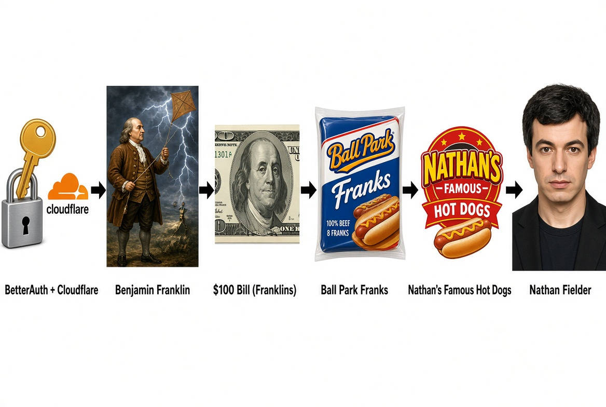
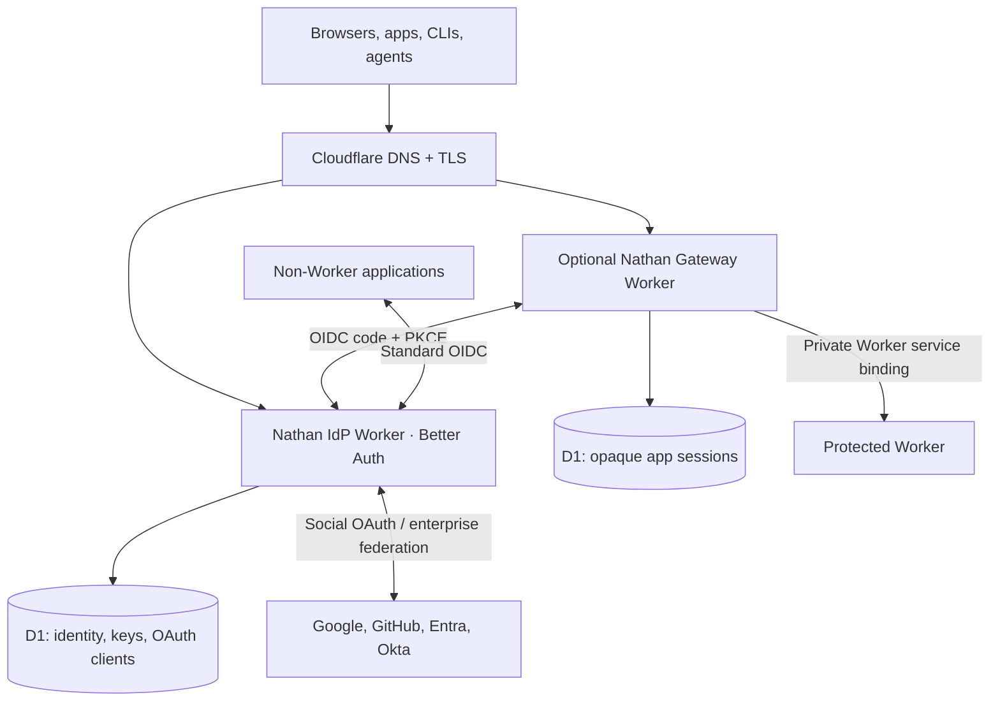

# nathan 🌭

**Authentication, SSO, and access control for Cloudflare Workers and everything else. Deploy it in your own account.**

Nathan is a developer-first, open-source blueprint built on [Better Auth](https://www.better-auth.com/) and [Cloudflare Workers](https://developers.cloudflare.com/workers/). It aims to make protecting an application a guided workflow: discover your Cloudflare account and hostnames, configure identity providers and MFA, register OIDC clients, create a private application gateway, then deploy and verify.

> [!WARNING]
> **Experimental, not production-ready.** The identity Worker, gateway, CLI, and SDK have initial implementations, but the complete OAuth flow, D1 migration, registration UI, MFA/SSO, and gateway origin isolation have **not yet passed live integration and security tests**. Do not use Nathan as your production IdP until the release gates in [the roadmap](docs/roadmap.md) pass.

## Why is it called Nathan?



Better Auth + Cloudflare → Benjamin Franklin → $100 **Franklins** → Ball Park Franks → Nathan's Famous Hot Dogs → Nathan Fielder.

Yes. That is the naming process. The illustration above is the **original PNG** provided for the project, not a recreation.

## What Nathan builds



One identity provider can serve apps on Cloudflare or elsewhere. Applications can consume Nathan via native Worker bindings, OIDC, or an HTTP gateway. A gateway is **not** proof of security unless every other origin route and preview is closed.

## What's implemented in the development branch?

| Area | Status |
| --- | --- |
| Better Auth Worker and OIDC provider configuration | **Code present; unverified** |
| Social OAuth, passkeys, two-factor, organizations, admin, optional enterprise SSO plugins | **Configured; integration tests pending** |
| Identity Studio sign-in, consent, and OIDC client registration | **Initial UI; validation pending** |
| OIDC gateway, encrypted state, PKCE, opaque D1 sessions, back-channel logout | **Code present; staging tests pending** |
| JWT verification SDK for protected APIs | **Initial implementation** |
| Cloudflare account/zone/Worker/DNS discovery | **Initial CLI implementation** |
| Local wizard, dry-run plan, guarded deployment flow | **Initial CLI implementation** |
| Hosted Cloudflare OAuth installer | **Read-only discovery and resumable publish workflow coded; live API testing pending** |
| Generated Better Auth + rate-limit migration | **Committed; CI regenerates and verifies** |
| Admin MCP tools and Identity Studio | **OIDC client, policy and enterprise SSO admin surfaces coded; conformance testing pending** |
| Sealed installer release upload | **Compiled and integrity-checked in CI; first live provisioning pending** |
| Node tests + three Worker CI bundles | **Passing in GitHub Actions** |
| End-to-end protocol/security audit and live deployment | **Not completed** |

No active deployment is claimed.

## Run the guided setup

For a developer with a scoped Cloudflare API token, the CLI wizard guides account discovery, DNS, Google/GitHub OAuth, application enrollment and administrator bootstrap:

```sh
git clone https://github.com/gmackie/nathan.git
cd nathan
git switch feat/bootstrap-blueprint
npm ci
# Configure CLOUDFLARE_API_TOKEN securely in your terminal environment
npm run wizard
```

To host a **browser-based Deploy to Cloudflare wizard** for others, configure a Cloudflare OAuth client (scopes include Workers Admin, Routes Write, D1 Write, Zone Read and account identity) and run:

```sh
npm run setup:installer
```

The bootstrap CLI asks for the installer hostname and Cloudflare OAuth client ID/secret, creates a dedicated installer D1 database, builds and verifies a pinned Nathan release, applies its installer migrations, stages the Worker privately, installs secrets, and publishes the installer at the selected hostname. Your visitors then sign into their own Cloudflare accounts via OAuth and use a browser wizard to deploy Nathan into those accounts.

**The production deployment path is experimental.** It needs a real OAuth client, authorized Cloudflare account and staging-domain tests before real customer use. See [installer instructions](docs/installer.md) and [MCP administration](docs/mcp.md).

## Local setup

Requires **Node.js 22+**. Start by cloning this repository and using the preview commands:

```sh
git clone https://github.com/gmackie/nathan.git
cd nathan
git switch feat/bootstrap-blueprint
npm ci
cp nathan.config.example.json nathan.config.json
npm test
npm run plan
npm run doctor
```

GitHub Actions installs the pinned lockfile, regenerates and validates the Better Auth schema, runs unit/migration tests, and dry-run bundles the IdP, gateway, and installer Workers. These build checks do not replace Cloudflare staging or end-to-end protocol/security tests.

```sh
# Read-only account and DNS discovery when configured
CLOUDFLARE_API_TOKEN=... npm run plan

# Interactive setup (local manifest, no infrastructure changes)
npm run init

# Display exact Google OAuth instructions and callback URL
node scripts/nathan.mjs providers guide google

# Identity Worker rollout: staging only until security gates pass
npm run schema:generate
node scripts/nathan.mjs deploy --apply

# Promote an existing verified allowlisted admin
node scripts/nathan.mjs admin promote --apply

# Check and protect a private Worker upstream
node scripts/nathan.mjs protect dashboard
```

**Do not rely on Nathan for production authentication at this stage.** The deployment script refuses to proceed without the committed Better Auth migration and blocks unverified high-assurance profiles; it also requires explicit consent and Cloudflare account verification. See [deployment instructions](docs/deploy.md).

The intended stable command will eventually be `npx nathan init` with a browser wizard, Cloudflare OAuth, provider-specific instructions and resumable provisioning.

## Architecture, security and contributions

- [Architecture and trust boundaries](docs/architecture.md)
- [Deploy and DNS setup](docs/deploy.md)
- [Hosted installer and Cloudflare OAuth](docs/installer.md)
- [Admin MCP setup and tool contracts](docs/mcp.md)
- [Threat model and operational assumptions](docs/threat-model.md)
- [Backups, rotation, and incident response](docs/operations.md)
- [OAuth/OIDC client integration](docs/oidc.md)
- [Plugin architecture and tiers](docs/plugins.md)
- [Security design and operational gates](docs/security.md)
- [Milestones and verification status](docs/roadmap.md)
- [Security disclosures](SECURITY.md) · [Contributing](CONTRIBUTING.md)

Nathan takes inspiration from [Coworkers](https://github.com/fayazara/coworkers), especially its self-hosted installer and resumption model; it does not reuse Coworkers' identity implementation.

**License:** [MIT](LICENSE).
