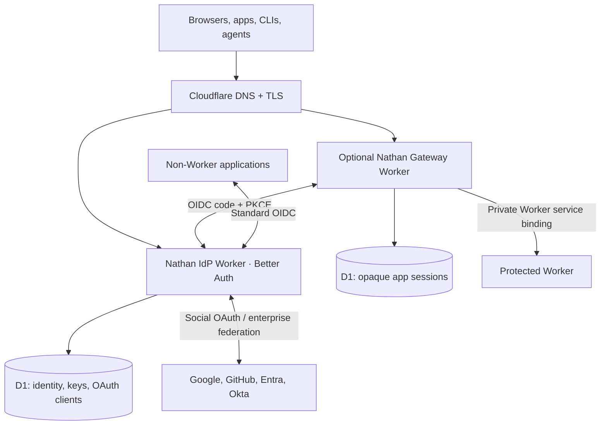

# nathan 🌭

**Authentication, SSO, and access control for Cloudflare Workers and everything else. Deploy it in your own account.**

Nathan is a developer-first, open-source blueprint built on [Better Auth](https://www.better-auth.com/) and [Cloudflare Workers](https://developers.cloudflare.com/workers/). It aims to make protecting an application a guided workflow: discover your Cloudflare account and hostnames, configure identity providers and MFA, register OIDC clients, create a private application gateway, then deploy and verify.

> [!WARNING]
> **Experimental, not production-ready.** The identity Worker, gateway, CLI, and SDK have initial implementations, but the complete OAuth flow, D1 migration, registration UI, MFA/SSO, and gateway origin isolation have **not yet passed live integration and security tests**. Do not use Nathan as your production IdP until the release gates in [the roadmap](docs/roadmap.md) pass.

## Why is it called Nathan?


Better Auth + Cloudflare → Benjamin Franklin → $100 **Franklins** → Ball Park Franks → Nathan's Famous Hot Dogs → Nathan Fielder.

Yes. That is the naming process. The illustration above is the **original PNG** provided for the project, not a recreation.

## What Nathan builds



One identity provider can serve apps on Cloudflare or elsewhere. Applications can consume Nathan via native Worker bindings, OIDC, or an HTTP gateway. A gateway is **not** proof of security unless every other origin route and preview is closed.

## What's implemented in the development branch?

| Area | Status |
| --- | --- |
| Better Auth Worker and OIDC provider configuration | **Code present; unverified** |
| Social OAuth, passkeys, two-factor, organizations, admin, optional enterprise SSO plugins | **Configured; integration tests pending** |
| Identity Studio sign-in, consent, and OIDC client registration | **Initial UI; validation pending** |
| OIDC gateway, encrypted state, PKCE, opaque D1 sessions, back-channel logout | **Code present; staging tests pending** |
| JWT verification SDK for protected APIs | **Initial implementation** |
| Cloudflare account/zone/Worker/DNS discovery | **Initial CLI implementation** |
| Local wizard, dry-run plan, guarded deployment flow | **Initial CLI implementation** |
| Fully hosted one-click Coworkers-style installer | **Not implemented** |
| Generated/validated Better Auth database migration | **Not committed; required before deploy** |
| End-to-end protocol/security audit and live deployment | **Not completed** |

No active deployment is claimed.

## Local setup

Requires **Node.js 22+**. Start by cloning this repository and using the preview commands:

```sh
git clone https://github.com/gmackie/nathan.git
cd nathan
git switch feat/bootstrap-blueprint
npm install
cp nathan.config.example.json nathan.config.json
npm test
npm run plan
npm run doctor
```

The repo is under active development: dependency installation, TypeScript builds, and full Worker integration have not yet been certified. The Node-only unit suite has 14 passing tests as of the latest local verification.

```sh
# Read-only account and DNS discovery when configured
CLOUDFLARE_API_TOKEN=... npm run plan

# Interactive setup (local manifest, no infrastructure changes)
npm run init

# Production rollout intentionally requires additional prerequisites:
npm run schema:generate
node scripts/nathan.mjs deploy --apply
```

**Do not deploy Nathan in production at this stage.** The deployment script refuses to proceed without a reviewed Better Auth migration; it also requires explicit consent and Cloudflare account verification. See [deployment instructions](docs/deploy.md).

The intended stable command will eventually be `npx nathan init` with a browser wizard, Cloudflare OAuth, provider-specific instructions and resumable provisioning.

## Architecture, security and contributions

- [Architecture and trust boundaries](docs/architecture.md)
- [Deploy and DNS setup](docs/deploy.md)
- [OAuth/OIDC client integration](docs/oidc.md)
- [Plugin architecture and tiers](docs/plugins.md)
- [Security design and operational gates](docs/security.md)
- [Milestones and verification status](docs/roadmap.md)
- [Security disclosures](SECURITY.md) · [Contributing](CONTRIBUTING.md)

Nathan takes inspiration from [Coworkers](https://github.com/fayazara/coworkers), especially its self-hosted installer and resumption model; it does not reuse Coworkers' identity implementation.

**License:** [MIT](LICENSE).
