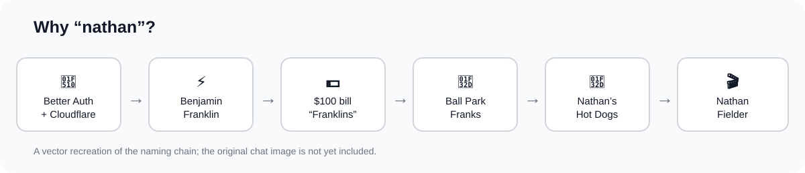
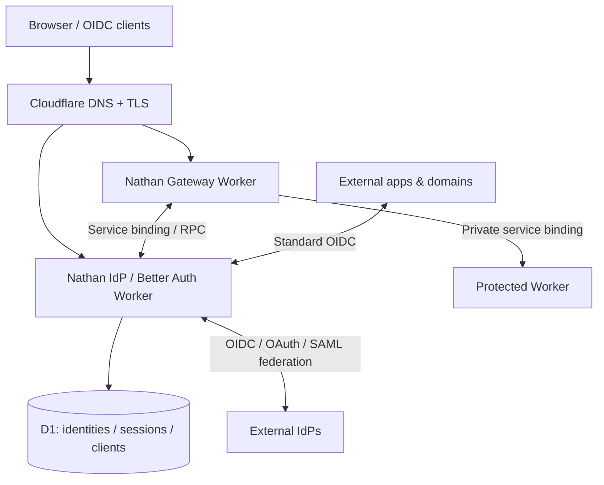

# nathan 🌭

**Bring your own Cloudflare account. Get an identity provider and app protection, without running an identity server.**

Nathan is an open development effort toward a developer-first identity and access blueprint built on Cloudflare Workers, D1 and [Better Auth](https://www.better-auth.com/). It aims to protect existing Workers, act as an OIDC identity provider for any domain, and give developers a guided installer rather than a pile of OAuth and DNS chores.

> [!WARNING]
> **Early bootstrap, not production-ready.** The committed CLI is a **read-only planner**, not an authentication service or installer. Do not use Nathan to secure production applications.

## Why “nathan”?



Better Auth + Cloudflare → Benjamin Franklin → $100 *Franklins* → Ball Park Franks → Nathan's Famous Hot Dogs → Nathan Fielder. The diagram above recreates the naming chain; the original image shared in the design conversation has not yet been uploaded into the repository.

## The goal

A developer should be able to select an existing Worker, choose an auth hostname, configure Google/GitHub or enterprise SSO using guided instructions, enable passkeys or MFA, preview the changes, and deploy. Native service bindings should protect private Worker backends; standard OIDC should work for external domains and applications.

**Target experience (planned):**

```sh
npx nathan init
npx nathan protect dashboard-worker
```

These commands are aspirations, **not published commands**.

## Current working commands

Clone the repository and use Node 20+:

```sh
cp nathan.config.example.json nathan.config.json
npm test
npm run plan
npm run doctor
```

`plan` validates the manifest and shows **proposed** Worker, D1, domain and application registration resources. It intentionally makes no API calls or infrastructure changes. `doctor` currently checks only local configuration.

## Infrastructure



*This is the intended deployment architecture, not yet operational code.*

## Design and implementation

- [Architecture and trust boundaries](docs/architecture.md)
- [Deployment path and installer model](docs/deploy.md)
- [Security requirements and release gates](docs/security.md)
- [Milestones and working status](docs/roadmap.md)

The eventual hosted installer is inspired by [Coworkers](https://github.com/fayazara/coworkers), particularly its Cloudflare OAuth, self-hosted deployment, resumable provisioning and release packaging approach. Nathan is not a fork of Coworkers.

## Contributors

Start with the [roadmap](docs/roadmap.md). Security-sensitive work should include integration tests and fail-closed behavior. We welcome discussion of the design; external contribution terms and license have not yet been finalized.

## License

**Not yet selected.** A public repository is not automatically licensed for redistribution or modification. We should choose an explicit license before inviting third-party reuse.
