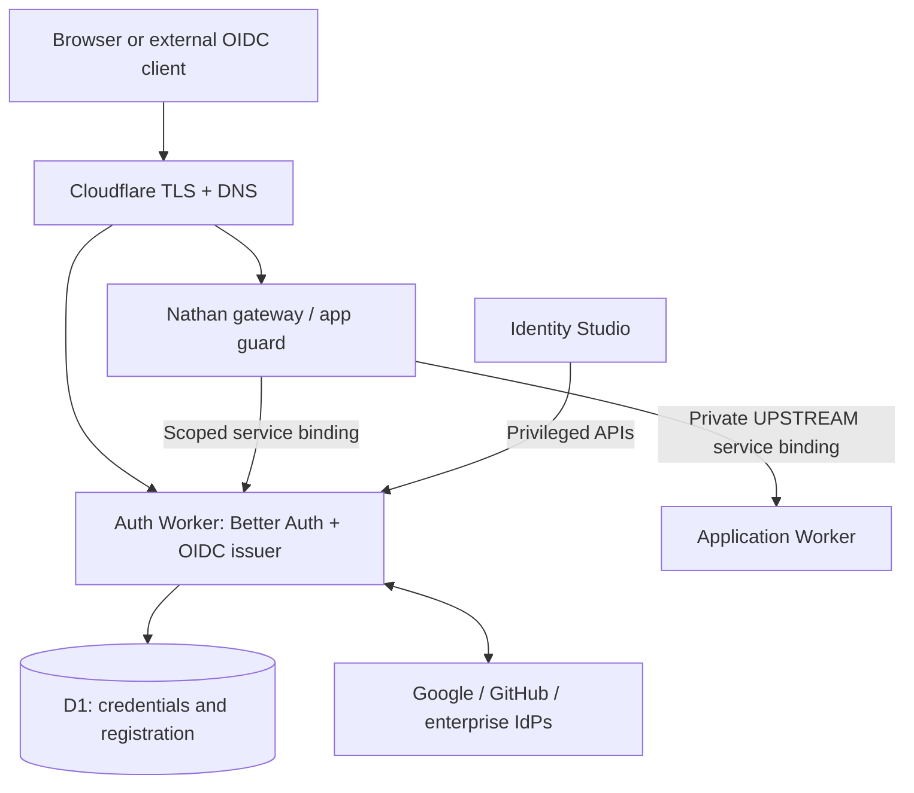

# Nathan architecture

Nathan's primary product is developer experience. It must offer a guided, resumable path from an existing application to a verified protected application.

## Trust boundaries

## Responsibilities

- **Identity Worker:** Better Auth runtime, user identity and sessions, OIDC authorization server, JWKS, token issuance, provider federation and plugin registration.
- **Registry:** Registered apps and OAuth clients; separate records for upstream IdPs vs downstream relying parties. Use the Better Auth protocol store as source of truth where possible.
- **Gateway:** Fail-closed OIDC login, callback, application session, per-request authorization. Reject forged identity headers; no upstream bypass.
- **SDK:** Hono/Workers/Effect middleware, exact issuer and audience verification, typed principal, privileged-action step-up.
- **CLI and hosted installer:** Account discovery, custom domains, OAuth guides and masked secret input, explicit plan/diff, idempotent reconciliation, rollback/resume.
- **Identity Studio:** Configuration via validated schemas with explicit compile-time vs runtime settings; privileged operations require re-authentication and audit.

## Client types

1. Native Worker protected by a service-binding guard (OIDC client optional).
2. Worker with dedicated gateway + private upstream service binding (OIDC client).
3. External web/mobile application using standards-based OIDC.
4. External legacy HTTP origin through a gateway, provided bypass is prevented.
5. Non-HTTP protocol outpost via separate edge agent (future).

## First release boundary

A deployable Better Auth identity Worker with D1 and a documented manual configuration path must precede automated cloud deployment. The planner in this repository **only reads local files** and currently does not deploy anything.

No production readiness claim until E2E OIDC, MFA, revocation, origin bypass, signing key lifecycle, session recovery and incident response are validated.

## Coworkers inspiration

[Coworkers](https://github.com/fayazara/coworkers) separates the deployable Worker release from a Cloudflare OAuth-powered installer, with a resumable workflow. Nathan should adopt that pattern while requesting the narrowest sufficient scopes, protecting installer tokens at rest, and showing every resource modification before applying it.
