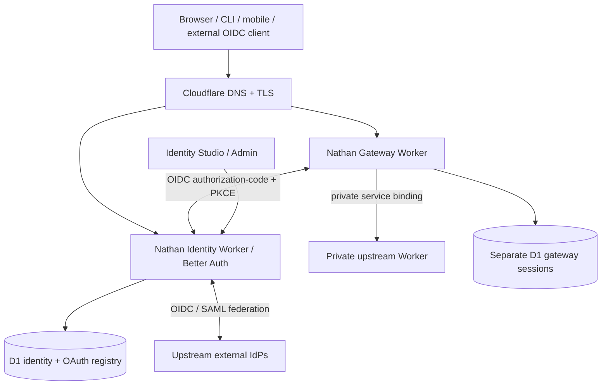

# Nathan architecture

Nathan aims to provide a one-setup customer-owned identity provider and application access system using Better Auth and Cloudflare Workers.

## Identity Provider

The identity Worker instantiates Better Auth inside the request using a D1 binding and installs the Better Auth OAuth Provider, JWT, organizations, admin, passkey and TOTP plugins, plus optional enterprise SSO. It exposes standard discovery metadata and OIDC clients independent of application location. Enterprise SAML consumption is distinct from acting as a downstream SAML identity provider.

Admin registration is restricted to verified Better Auth admin users whose email is separately allowlisted in deploy secrets/configuration. No unprotected bootstrap API is exposed.

## Gateway

Browser requests first hit the gateway. It performs OIDC code + PKCE with a nonce and a short-lived AES-GCM-encrypted flow cookie. It validates ID token issuer, audience, nonce, signature and authentication assurance, then issues a random opaque host-only session cookie. Session handles are SHA-256-hashed in a per-gateway D1 database, and every request checks expiration and current session existence. Requests with no valid session receive 401 or an interactive redirect. Incoming identity headers are removed before forwarding to the private upstream Worker.

**Important:** Gateway ID tokens do not currently prove NIST AAL2. Better Auth's OAuth Provider advertises `acr: "0"` by default. If an application requires AAL2, its gateway must fail closed until an assurance-capable upstream implementation is verified.

## Native Worker SDK

A Worker can use JWT bearer verification for protected APIs. Tokens must be resource-bound (`aud`) and verified using Nathan's JWKS, not trusted based on headers. Service-binding RPC is available for session verification in same-account Workers. Application permissions remain application-specific.

## Infrastructure and ownership

Default: identity Worker + D1 + custom auth hostname. Optional gateways: one Worker and one D1 per protected origin. Optional email: Resend API (or future adapter). Resource bindings are customer-owned. Prefer Cloudflare Custom Domains to hand-creating DNS records. External domains require no DNS changes when integrating as OIDC clients.

## Deployment and plugins

The local CLI discovers account and zone resources with Cloudflare's API, validates configuration, computes a read-only plan, and requires explicit confirmation before deployment. The hosted Coworkers-style installer now supports Cloudflare OAuth, encrypted session storage, read-only account discovery and planning; its publish path is disabled until the packaged release upload and migration sequence pass staging tests. The production reconciler, live plugin installer and external policy engine remain roadmap items.

Plugin code executes in the IdP's trust boundary: arbitrary third-party hooks cannot safely be sandboxed merely through a UI manifest.
